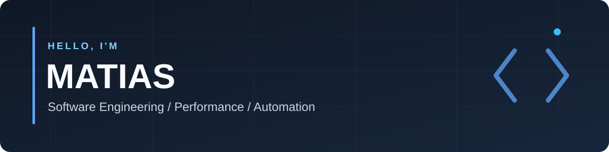

  
    
  <strong>Software Engineer · Performance & Automation · AI Engineering</strong>
   
  Building reliable systems, improving developer workflows, and exploring practical AI.
   
  Construyendo sistemas confiables, optimizando flujos de desarrollo y explorando aplicaciones reales de IA.

---

### 👋 About me · Sobre mí

**EN** 🇬🇧

I'm Matias, a software engineer based in Argentina, working at the intersection of **system performance, backend engineering, and automation**. I enjoy improving the way software is built and operated—from developer tooling and architectural decisions to practical uses of AI.

I'm currently expanding my skills in **AI Engineering**, with a focus on **Python, software design, and intelligent workflows**.

**ES** 🇦🇷

Soy Matías, desarrollador de software de Argentina, con foco en **performance de sistemas, desarrollo backend y automatización**. Me interesa mejorar cómo se desarrolla y opera el software: desde herramientas para equipos técnicos y decisiones de arquitectura hasta aplicaciones prácticas de inteligencia artificial.

Actualmente estoy profundizando mis conocimientos en **AI Engineering**, especialmente en **Python, diseño de software y flujos inteligentes**.

### 🛠️ Technologies · Tecnologías

**Engineering / Experiencia y herramientas**

**Learning & building / Aprendiendo y construyendo**

### 🔭 Current focus · En qué estoy trabajando

- **Performance & developer experience** — tooling, automation and architectural improvements.  
  **Performance y experiencia de desarrollo** — herramientas, automatización y mejoras de arquitectura.
- **AI Engineering** — learning to design and build practical AI-powered applications.  
  **Ingeniería de IA** — aprendiendo a diseñar y construir aplicaciones reales con IA.
- **Python & software design** — writing maintainable, testable code.  
  **Python y diseño de software** — desarrollando código mantenible y testeable.

### 📌 Projects · Proyectos

I'm building a collection of practical, well-documented projects. Public repositories will be featured here as they're ready.

Estoy armando una colección de proyectos reales, con código y documentación técnica. Voy a destacar los repositorios públicos cuando estén listos.

> **My approach / Mi enfoque:** solve a real problem, explain design decisions, document trade-offs, and make the result reproducible.  
> Resolver problemas concretos, explicar decisiones de diseño, documentar compromisos técnicos y facilitar la reproducción del proyecto.

### 🤝 Let's connect · Conectemos

- 💬 Open to exchanging ideas about **backend, system performance, automation, and AI**.  
  Abierto a conversar sobre **backend, performance, automatización e inteligencia artificial**.
- 📂 Explore my work: [github.com/Cold30](https://github.com/Cold30)

---

  Keep building. Keep learning. · Seguir construyendo. Seguir aprendiendo.

